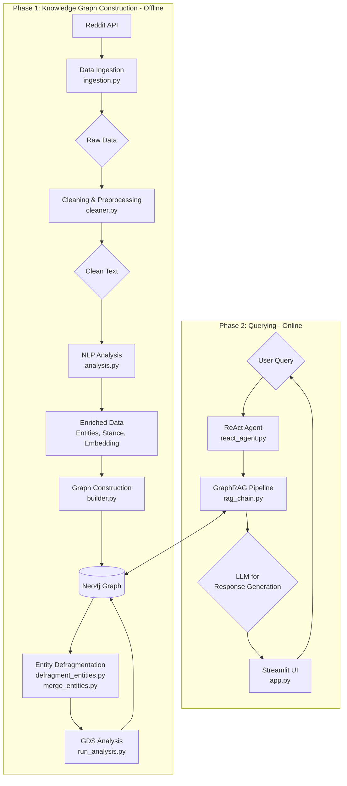

# Reddit Political Opinion Analyzer (GraphRAG)

Una pipeline end-to-end che trasforma la discussione politica su Reddit in un knowledge graph interrogabile su Neo4j, e risponde alle domande con una catena GraphRAG: entità e posizioni vengono risolte prima sul grafo, poi riordinate per similarità vettoriale, così una risposta può dire *chi* ha detto *cosa su chi* invece di restituire i documenti che condividono le parole.

## Indice

- [Cosa fa](#cosa-fa)
- [Come funziona](#come-funziona)
- [Decisioni](#decisioni)
- [Mappa del repository](#mappa-del-repository)
- [Eseguirlo](#eseguirlo)
- [Limiti](#limiti)

## Cosa fa

- **Ingerisce** post e commenti da subreddit politici tramite PRAW.
- **Arricchisce** ogni testo con entità nominate, una posizione verso ciascuna entità (favorevole, contraria, neutrale) e un embedding denso.
- **Costruisce** un knowledge graph: post, commenti, entità politiche, posizioni e riassunti di comunità.
- **Rileva comunità** di utenti con allineamento ideologico coerente con l'algoritmo di Leiden in Neo4j GDS, e sintetizza ogni ideologia dai post più rappresentativi.
- **Risponde** in linguaggio naturale tramite un agente ReAct sul grafo, con un'interfaccia Streamlit che disegna anche il grafo stesso.

## Come funziona

### Fase 1 — costruire il grafo

Quattro stadi sequenziali, orchestrati da `run_pipeline.py`:

1. **Ingestione** — scarica, pulisce e analizza: NER, stance detection e generazione degli embedding, poi scrive nodi e relazioni su Neo4j.
2. **Deframmentazione** — riconduce gli alias della stessa persona o organizzazione ("Bernie", "Bernie Sanders") a un'unica entità canonica.
3. **Merge** — riconcilia i nodi prodotti da esecuzioni diverse della pipeline.
4. **Community detection e summarization** — Leiden sul grafo delle interazioni, poi un riassunto per ogni coppia `(entità, posizione)` con abbastanza post ad alta confidenza.

### Fase 2 — rispondere a una domanda

1. L'**agente ReAct** legge la domanda ed estrae le entità e l'intenzione di posizione.
2. Il **retrieval gerarchico** interroga il grafo per entità e posizione — la metà strutturata della risposta — con `top_k = 10`.
3. Il **reranking semantico** ordina quei candidati per similarità vettoriale con la domanda.
4. Se non viene trovata alcuna entità strutturata, un **fallback vettoriale** interroga l'intero dataset tramite l'indice vettoriale di Neo4j, così il sistema restituisce comunque qualcosa.
5. Il modello compone la risposta da quel contesto.

### Il modello del grafo

Nodi: `Post`, `Comment`, `PoliticalEntity`, `IdeologicalSummary`. Le posizioni vivono sulla relazione `HAS_STANCE`, con la frase in cui sono state espresse.

Tre indici vettoriali su Neo4j, tutti a **768 dimensioni** e coseno: `post_embedding`, `comment_embedding`, `ideological_summary_embedding`. 768 è la dimensione di uscita di `all-mpnet-base-v2`, il modello di embedding che la pipeline carica.



## Decisioni

**Prima il grafo, poi i vettori.** La sola ricerca vettoriale risponde a "post sulla sanità" ma non a "chi ha criticato il candidato sulla sanità". La query strutturata produce un insieme di candidati molto più piccolo e mirato; il reranking con embedding lo ordina. Invertire l'ordine significherebbe filtrare per similarità e perdere il vincolo sull'entità.

**Un fallback vettoriale invece di una risposta vuota.** Quando la domanda non nomina nulla che il grafo conosca, una ricerca vettoriale pura sull'intero dataset tiene in piedi l'assistente. Il prezzo è un degrado silenzioso — la risposta smette di essere ancorata alle entità — ed è per questo che il fallback ha un suo `top_k` (3) e non finge di essere il percorso strutturato.

**Stance detection con il modello linguistico, non con un classificatore addestrato.** La posizione viene estratta con output JSON strutturato dallo stesso modello locale che fa il NER, a temperatura 0. Un classificatore dedicato sarebbe più preciso e molto più economico per token, ma richiederebbe dati etichettati per questo dominio, e il progetto non ne aveva.

**Due istanze del modello a due quantizzazioni.** Una `q4_K_M` con `format="json"` e timeout di 30 secondi per estrazione e classificazione, una `q8_0` con timeout di 180 secondi per la generazione libera. Entrambe a temperatura 0: la prima perché l'output viene parsato, la seconda perché un agente non deterministico smette di seguire i suoi strumenti.

**Leiden con γ = 1.5.** Il parametro di risoluzione è fissato esplicitamente e non lasciato al default, perché è quello che decide se la politica di un paese diventa un blocco solo o diversi. Viene scritto nel grafo come `communityId`.

**Una mappa di alias manuale.** `canonical_map.json` è curata a mano: alias e maiuscole della stessa figura collassano su un nome canonico. È economica e prevedibile, non richiede che un modello abbia ragione — ma va mantenuta.

## Mappa del repository

```
app.py                 interfaccia Streamlit: chat, disegno del grafo, esplorazione
run_pipeline.py        esegue in ordine i quattro stadi offline
canonical_map.json     alias -> nomi canonici delle entità, curata a mano
src/data_processing/   ingestione (PRAW) e pulizia
src/nlp/               NER, stance detection, embedding
src/graph/             schema, builder, deframmentazione, GDS/Leiden, summarizer
src/pipeline/          la catena GraphRAG: retrieval gerarchico, fallback vettoriale, prompt
src/agent/             l'agente ReAct che decide quale retrieval usare
src/llm/               le due istanze ChatOllama e i parser JSON
```

## Eseguirlo

Requisiti: Python 3.10+, un'istanza Neo4j 5 con il plugin **Graph Data Science**, e Ollama con il modello scaricato.

```bash
pip install -r requirements.txt
ollama pull qwen3:4b-instruct-2507-q8_0
ollama pull qwen3:4b-instruct-2507-q4_K_M
```

Ambiente (`.env`):

```
REDDIT_CLIENT_ID=...
REDDIT_CLIENT_SECRET=...
REDDIT_USER_AGENT=...
NEO4J_URI=bolt://localhost:7687
NEO4J_USER=neo4j
NEO4J_PASSWORD=...
```

Poi:

```bash
python run_pipeline.py     # ingestione, deframmentazione, merge, comunità
streamlit run app.py       # l'interfaccia su http://localhost:8501
```

`run_pipeline.py` costruisce gli stadi con `sys.executable`, quindi lo stesso comando funziona su Windows e su Linux.

## Limiti

| Cosa | Impatto | Stato |
|---|---|---|
| Nessuna qualità di retrieval misurata | non c'è una cifra di recall, precision o fedeltà per la catena GraphRAG: il disegno a due stadi è argomentato, non misurato | aperto, il buco più grande |
| `pytest` è nei requirements ma non ci sono test | la pipeline si valida eseguendola e guardando il grafo | aperto |
| La stance detection è non deterministica in principio | la temperatura 0 la rende stabile, non corretta; non esiste un insieme etichettato per misurarne l'errore | aperto |
| La mappa degli alias è manuale e sensibile alle maiuscole | `kamala harris` e `Kamala Harris` compaiono come due voci canoniche, quindi alcuni alias non verranno uniti | aperto, visibile nei dati |
| I dati grezzi non sono versionati | un clone pulito richiede credenziali Reddit e un'esecuzione dal vivo dell'ingestione | per scelta |
| Coursework di *Information Retrieval and NLP*, autunno 2025 | la pipeline è stata costruita su una scadenza di corso, non su un SLA di produzione | annotato |

---

*Sviluppato come progetto per il corso "Information Retrieval and Natural Language Processing", autunno 2025, docente prof. Andrea Tagarelli, Dipartimento DIMES, Università della Calabria.*
