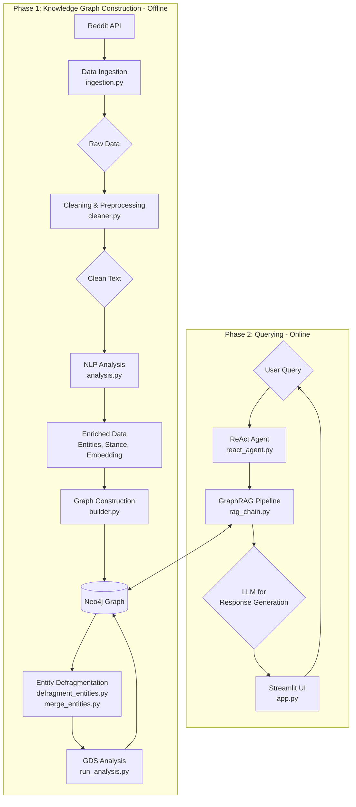

# Reddit Political Opinion Analyzer (GraphRAG)

An end-to-end pipeline that turns Reddit political discussion into a queryable knowledge graph on Neo4j, and answers questions about it with a GraphRAG chain: entities and stances are resolved through the graph first, then re-ranked by vector similarity, so an answer can say *who* said *what about whom* instead of returning the documents that merely share the words.

## Table of contents

- [What it does](#what-it-does)
- [How it works](#how-it-works)
- [Decisions](#decisions)
- [Repository map](#repository-map)
- [Running it](#running-it)
- [Limitations](#limitations)

## What it does

- **Ingests** posts and comments from political subreddits through PRAW.
- **Enriches** each text with named entities, a stance towards each entity (favorable, opposing, neutral) and a dense embedding.
- **Builds** a knowledge graph: posts, comments, political entities, stances and community summaries.
- **Detects communities** of users with consistent ideological alignment through the Leiden algorithm in Neo4j GDS, and summarises each ideology from the most representative posts.
- **Answers** in natural language through a ReAct agent over the graph, with a Streamlit UI that also renders the graph itself.

## How it works

### Phase 1 — building the graph

Four sequential stages, orchestrated by `run_pipeline.py`:

1. **Ingestion** — fetch, clean and analyse: NER, stance detection and embedding generation, then write the nodes and relations to Neo4j.
2. **Defragmentation** — collapse the aliases of the same person or organisation ("Bernie", "Bernie Sanders") onto one canonical entity.
3. **Merging** — reconcile nodes produced by different runs of the pipeline.
4. **Community detection and summarisation** — Leiden on the interaction graph, then a summary for each `(entity, stance)` pair with enough high-confidence posts.

### Phase 2 — answering a query

1. The **ReAct agent** reads the question and extracts the entities and the stance intent.
2. **Hierarchical retrieval** queries the graph by entity and stance — the structured half of the answer — with `top_k = 10`.
3. **Semantic re-ranking** orders those candidates by vector similarity to the question.
4. If no structured entity is found, a **vector fallback** queries the whole dataset through the Neo4j vector index, so the system always returns something.
5. The LLM composes the answer from that context.

### The graph model

Nodes: `Post`, `Comment`, `PoliticalEntity`, `IdeologicalSummary`. Stances live on the `HAS_STANCE` relationship, with the sentence where they were expressed.

Three vector indexes on Neo4j, all **768 dimensions** and cosine: `post_embedding`, `comment_embedding`, `ideological_summary_embedding`. 768 is the output size of `all-mpnet-base-v2`, the embedding model the pipeline loads.



## Decisions

**Graph first, vectors second.** Pure vector search answers "posts about healthcare" but not "who criticised the candidate on healthcare". The structured query produces a much smaller, semantically targeted candidate set; the embedding re-ranking then orders it. Reversing the order would mean filtering by similarity and losing the entity constraint.

**A vector fallback instead of an empty answer.** When the question names nothing the graph knows, a pure vector search over the whole dataset keeps the assistant useful. The cost is a quiet degradation — the answer stops being entity-grounded — which is why the fallback has its own `top_k` (3) and does not pretend to be the structured path.

**Stance detection through the LLM, not a fine-tuned classifier.** The stance is extracted with structured JSON output from the same local model that does the NER, at temperature 0. A dedicated classifier would be more precise and far cheaper per token, but it would need labelled data for this domain, and the project had none.

**Two model instances at two quantisations.** A `q4_K_M` instance with `format="json"` and a 30-second timeout for extraction and classification, and a `q8_0` instance with a 180-second timeout for free-text generation. Both at temperature 0: the first because the output is parsed, the second because a nondeterministic agent stops following its tools.

**Leiden at γ = 1.5.** The resolution parameter is set explicitly rather than defaulted, because it is what decides whether the country's politics becomes one bloc or several. It is written into the graph as `communityId`.

**A manual alias map.** `canonical_map.json` is hand-curated: aliases and capitalisations of the same figure collapse to one canonical name. Cheap and predictable, and it does not need a model to be right — but it has to be maintained.

## Repository map

```
app.py                 Streamlit UI: chat, graph rendering, exploration
run_pipeline.py        runs the four offline stages in order
canonical_map.json     alias -> canonical entity names, curated by hand
src/data_processing/   ingestion (PRAW) and cleaning
src/nlp/               NER, stance detection, embeddings
src/graph/             schema setup, builder, defragmentation, GDS/Leiden, summarizer
src/pipeline/          the GraphRAG chain: hierarchical retrieval, vector fallback, prompts
src/agent/             the ReAct agent that decides which retrieval to run
src/llm/               the two ChatOllama instances and the JSON parsers
```

## Running it

Requirements: Python 3.10+, a Neo4j 5 instance with the **Graph Data Science** plugin, and Ollama with the model pulled.

```bash
pip install -r requirements.txt
ollama pull qwen3:4b-instruct-2507-q8_0
ollama pull qwen3:4b-instruct-2507-q4_K_M
```

Environment (`.env`):

```
REDDIT_CLIENT_ID=...
REDDIT_CLIENT_SECRET=...
REDDIT_USER_AGENT=...
NEO4J_URI=bolt://localhost:7687
NEO4J_USER=neo4j
NEO4J_PASSWORD=...
```

Then:

```bash
python run_pipeline.py     # ingestion, defragmentation, merge, communities
streamlit run app.py       # the UI on http://localhost:8501
```

`run_pipeline.py` builds its stages with `sys.executable`, so the same command works on Windows and on Linux.

## Limitations

| Item | Impact | Status |
|---|---|---|
| No measured retrieval quality | there is no recall, precision or faithfulness figure for the GraphRAG chain: the two-stage design is argued, not measured | open, the biggest gap |
| `pytest` is in the requirements but there are no tests | the pipeline is validated by running it and reading the graph | open |
| Stance detection is non-deterministic in principle | temperature 0 makes it stable, not correct; there is no labelled set to measure the error | open |
| The alias map is manual and case-sensitive | `kamala harris` and `Kamala Harris` appear as two canonical entries, so some aliases will not merge | open, visible in the data |
| Raw data is not versioned | a clean clone needs Reddit credentials and a live ingestion run | by choice |
| Coursework for *Information Retrieval and NLP*, Fall 2025 | the pipeline was built against a course deadline, not a production SLA | noted |

---

*Developed as coursework for the class "Information Retrieval and Natural Language Processing", Fall 2025, instructor prof. Andrea Tagarelli, DIMES Department, University of Calabria, Italy.*
