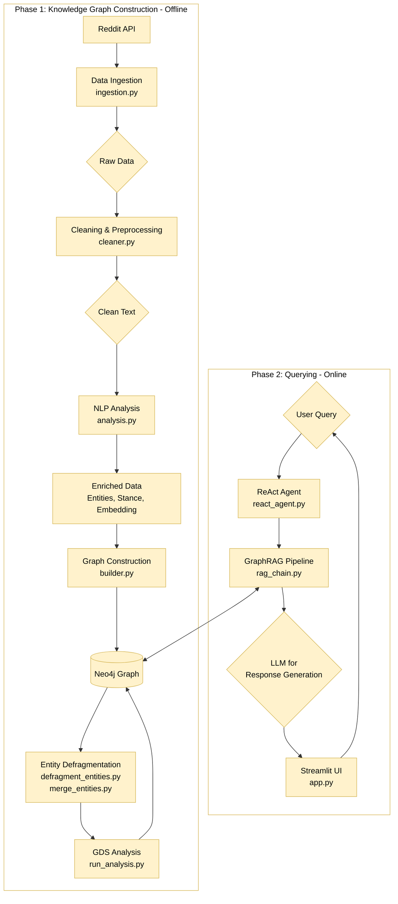

# Reddit Political Opinion Analyzer (GraphRAG)

## Project Overview

This project is an end-to-end system designed to analyze political discussions on the Reddit platform. It implements a sophisticated **GraphRAG (Retrieval-Augmented Generation)** pipeline that transforms unstructured textual content into a structured and queryable knowledge graph, hosted on Neo4j.

The main objective is to overcome the limitations of traditional keyword-based searches and purely vector-based RAG systems, offering a deeper and more contextualized semantic analysis of political opinions. The user interface, built with Streamlit, provides an intuitive entry point to explore data and interact with a reasoning agent based on LangChain.

### Key Features

- **Two-Stage Hybrid Retrieval**: The system employs a hierarchical retrieval strategy. Queries are first resolved by querying the graph structure to identify relevant entities and relationships (e.g., who mentioned a political figure). Results are then semantically re-ranked via vector similarity to maximize relevance.
    
- **Dynamic Vector Fallback**: In case no structured entity is found, the system transparently executes a pure vector search on the entire dataset, ensuring a response is always provided.
    
- **Advanced NLP Enrichment**: Data collected from Reddit undergoes in-depth NLP analysis, including:
    
    - **Named Entity Recognition (NER)** to identify political figures, organizations, and concepts.
        
    - **Stance Detection** to classify opinions as favorable, opposing, or neutral.
        
    - **Vector Embedding Generation** to capture the semantic meaning of the text.
        
- **Community Detection and Ideological Alliances**: Graph analysis algorithms (Leiden) are applied to identify clusters of users with similar ideological alignments, based on the consistency of their expressed positions.
    
- **Semantic Summaries**: The system generates high-level summaries for identified ideologies, aggregating and synthesizing the most representative posts and comments regarding a specific stance on an entity.
    

## System Architecture

The operational flow is divided into two main phases: an offline pipeline for graph construction and enrichment, and an online pipeline for real-time querying.




## Tech Stack

- **Backend and Orchestration**: Python 3.10+
    
- **Web Interface**: Streamlit
    
- **Graph Database**: Neo4j 5.x
    
- **Data Ingestion**: PRAW / asyncpraw
    
- **NLP Processing**: spaCy, Hugging Face Transformers
    
- **Vector Embeddings**: Sentence-Transformers
    
- **LLM Orchestration**: LangChain
    

This command will start a local server and open the application in the browser, allowing you to query the knowledge graph.

## Project Structure

```
.
├── app.py              # Streamlit application entry point
├── data/               # Raw and processed data (excluded from Git)
├── requirements.txt    # Python dependencies
├── run_pipeline.py     # Orchestrator script for the entire pipeline
├── src/                # Project source code
│   ├── agent/          # Logic for the ReAct agent
│   ├── data_processing/# Scripts for data ingestion and cleaning
│   ├── graph/          # Modules for graph construction, analysis, and schemas
│   ├── llm/            # Core for interaction with language models
│   ├── nlp/            # Functions for NLP analysis (NER, stance, embeddings)
│   ├── pipeline/       # RAG chain logic and query templates
│   ├── scripts/        # Auxiliary scripts (merge, defragment, etc.)
│   └── utils/          # Utility functions (e.g., configuration management)
```

---
##### This project has been developed as a coursework assigned for the class "Information Retrieval and Natural Language Processing", Fall 2025 (Instructor: prof. [Andrea Tagarelli](https://mlnteam-unical.github.io/ "https://mlnteam-unical.github.io/")) at the DIMES Department, University of Calabria, Italy
